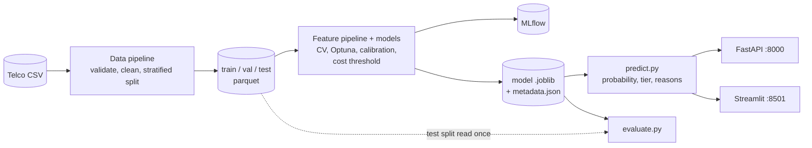

# ChurnGuard

End-to-end telecom churn prediction: a leakage-safe data pipeline, tracked experiments, a calibrated
model, a cost-based targeting threshold, SHAP reasons in plain English, a FastAPI service and a
Streamlit dashboard, packaged with Docker.

It answers one practical question: **given a retention budget, which customers should we contact, and
why?** See [PRD.md](PRD.md) for scope, [CLAUDE.md](CLAUDE.md) for the build rules and
[reports/MODEL_CARD.md](reports/MODEL_CARD.md) for the full, honest account of what the model can and
cannot do.

> **Money figures are an assumption-driven simulation.** Offer cost, success rate and customer lifetime
> value are assumptions in `configs/business.yaml`, not measured facts. The churn model itself is
> evaluated on real held-out data; the dollar values built on top of it are illustrations of the method.

## Results

Held-out **test split** (1,057 customers, scored once after every choice was fixed), 95% bootstrap
confidence intervals:

| Metric | Result | 95% CI | Target | Status |
|---|---|---|---|---|
| PR-AUC (primary) | **0.673** | [0.613, 0.731] | >= 0.64 | met |
| ROC-AUC | **0.842** | [0.816, 0.869] | >= 0.84 | met on the point estimate, borderline |
| Recall at chosen threshold | 0.861 | [0.820, 0.901] | >= 0.70 | met |
| Top-decile lift | 3.05 | [2.69, 3.39] | >= 2.8 | met |
| Brier score | 0.138 | [0.125, 0.151] | <= 0.15 | met |
| Net value vs "contact everyone" | +4,630 (+22%) | | strictly higher | met (simulation) |
| Single-prediction latency, p95 | 132 ms in Docker (median 99 ms) | < 100 ms | **narrowly missed** |

Every accuracy target is met on its point estimate, but the intervals are wide: the ROC-AUC lower bound
(0.816) is under its target. Precision at the chosen threshold is only 0.45, because the threshold is
deliberately low (see below). Latency was measured server-side over 45 requests in the Linux container
(16 CPUs); on a native Windows laptop run it was far slower (median 334 ms, p95 962 ms). The cause and the
options are in the [model card](reports/MODEL_CARD.md#9-limitations).

**Model choice (5-fold CV on the training split, PR-AUC):** dummy 0.265, logistic regression 0.662,
random forest 0.657, XGBoost 0.657, LightGBM 0.651. The four real models are statistically
indistinguishable; XGBoost won on the validation split (0.656 vs 0.636) after tuning with Optuna.
SMOTE never beat class weights. Details: [reports/model_comparison.md](reports/model_comparison.md).

**Targeting under the assumed economics** (test split, actual outcomes):

| Strategy | Contacted | Net value | Churners reached |
|---|---|---|---|
| Contact nobody | 0 | 0 | 0% |
| Contact everyone | 1,057 | 21,010 | 100% |
| Default 0.5 threshold | 229 | 17,620 | 53% |
| **Cost-optimal threshold (0.140)** | 533 | **25,640** | 86% |
| Best list within a 3,000 budget | 148 | 13,240 | 38% |

Contacting everyone is already profitable under these assumptions (26.6% churn is well above the 13.3%
break-even), so the model's value is in skipping the low-risk half, and the budget is a binding limit.

## Architecture



Design rules that shape the code (from [CLAUDE.md](CLAUDE.md)):

- **No leakage.** Every transformer lives inside one scikit-learn pipeline and is fit on training folds
  only; a test checks a customer's features do not change when other customers change.
- **The test split is read once**, by `evaluate.py`, which refuses to run twice in a checkout without
  `--force`. Selection, calibration and the threshold all use the validation split.
- **One inference path.** The API and the dashboard both call `src/churnguard/predict.py`.
- **Config over constants.** Model settings in `configs/model.yaml`, business assumptions in
  `configs/business.yaml`, seeds fixed at 42.

## Quickstart

Needs Python 3.11 (or [uv](https://docs.astral.sh/uv/), which installs it) and GNU `make`
(on Windows without it: `mingw32-make`, or `choco install make`).

```bash
make setup      # virtualenv + dependencies
make data       # download the IBM Telco CSV, validate, clean, split (writes data/processed)
make train      # CV comparison, Optuna, calibration, threshold, SHAP figures (about 3 minutes)
make evaluate   # score the test split ONCE and write reports/ and the figures
make test       # pytest with coverage (the suite needs >= 80%)
make lint       # ruff and black --check
make api        # FastAPI on http://localhost:8000 (docs at /docs)
make app        # Streamlit on http://localhost:8501
make mlflow     # MLflow UI for the tracked experiments
```

A fresh clone already contains the trained model (`models/churn_model_v1.joblib`) and the committed
reports, so after `make setup data` the `make api` and `make app` targets work immediately. `make train`
retrains it; with fixed seeds it reproduces the same metrics.

If the download fails, put the Kaggle copy (`WA_Fn-UseC_-Telco-Customer-Churn.csv`) at
`data/raw/telco_churn.csv` and re-run `make data` to record its checksum.

**Verified from a clean copy** (no data, virtualenv, MLflow store or git history):
`make setup data train evaluate test lint` succeeded in about 12 minutes (training 3 min 9 s), with 179
tests passing at 92% coverage. The retrained model reproduced the committed test metrics **exactly**
(identical PR-AUC, ROC-AUC, confidence intervals, hyperparameters and threshold).

### Docker

```bash
make data                  # once: the dashboard reads data/processed (mounted, not baked in)
docker compose up --build  # or: make docker-up
```

API on http://localhost:8000, dashboard on http://localhost:8501. One multi-stage image, non-root user,
runtime dependencies pinned in `requirements.lock` (training-only MLflow and Optuna are left out).

## API

| Endpoint | Method | Behavior |
|---|---|---|
| `/health` | GET | Liveness and the model version loaded |
| `/model/info` | GET | Metrics, threshold, features, training time |
| `/predict` | POST | One customer, returns probability, risk tier, `will_target`, reasons |
| `/predict/batch` | POST | Up to 1,000 customers; `?explain=false` skips reasons |
| `/predict/csv` | POST | Upload a CSV (max 1,000 rows, 2 MB); returns it with score columns added |

```bash
curl -s -X POST localhost:8000/predict -H "Content-Type: application/json" -d '{
  "gender": "Female", "SeniorCitizen": 0, "Partner": "No", "Dependents": "No", "tenure": 2,
  "PhoneService": "Yes", "MultipleLines": "No", "InternetService": "Fiber optic",
  "OnlineSecurity": "No", "OnlineBackup": "No", "DeviceProtection": "No", "TechSupport": "No",
  "StreamingTV": "No", "StreamingMovies": "No", "Contract": "Month-to-month",
  "PaperlessBilling": "Yes", "PaymentMethod": "Electronic check",
  "MonthlyCharges": 89.1, "TotalCharges": 178.2}'
```

returns a probability of about 0.73, tier `High`, `will_target: true`, and reasons such as
"Tenure of 2 months raises churn risk" and "Month-to-month contract raises churn risk". Invalid input
(a bad category, a missing field, an out-of-range number) gets a 422 that names the field.

## Dashboard

| Page | What it does |
|---|---|
| Overview | Churn rate, and churn by contract, tenure and services, with filters |
| Model | Test metrics with confidence intervals, curves, SHAP, slices, model comparison |
| Score a customer | Form, probability gauge, plain-English reasons, SHAP waterfall |
| Campaign simulator | Sliders for budget, offer cost, success rate and lifetime value; ranked target list; CSV download |

| Overview | Model |
|---|---|
|  |  |

| Score a customer | Campaign simulator |
|---|---|
|  |  |

## Monitoring

`scripts/drift_check.py` computes the Population Stability Index per feature between the training data and
a new file and flags any feature above 0.2 (exit code 1 if so):

```bash
python scripts/drift_check.py new_customers.csv --out drift.csv
```

It is a demonstration of the idea on a file, not a live service.

## Repository layout

```
configs/        model.yaml, business.yaml (all settings and assumptions)
src/churnguard/
  data/         load, validate, clean, split, drift (PSI)
  features/     feature engineering and the preprocessing pipeline
  models/       model factory, CV, Optuna tuning, calibration, MLflow tracking
  evaluation/   metrics, cost-based threshold, plots, the run-once test evaluation
  explain/      SHAP explainer, plain-English reasons, global SHAP report
  api/          FastAPI app, schemas, CSV validation
  predict.py    the single inference entrypoint
app/            Streamlit dashboard (4 pages)
scripts/        download_data.py, drift_check.py
tests/          pytest suite (data, features, leakage, metrics, cost, models, API, app, drift)
reports/        model card, comparison, evaluation, figures
notebooks/      01_eda.ipynb (training split only)
```

## Development

CI (`.github/workflows/ci.yml`) runs ruff, black and pytest with an 80% coverage floor on every push.
Pre-commit hooks run the same linters locally (`pre-commit install`). The business simulation is labelled
as assumption-driven everywhere it appears (dashboard, API docs, model card).
