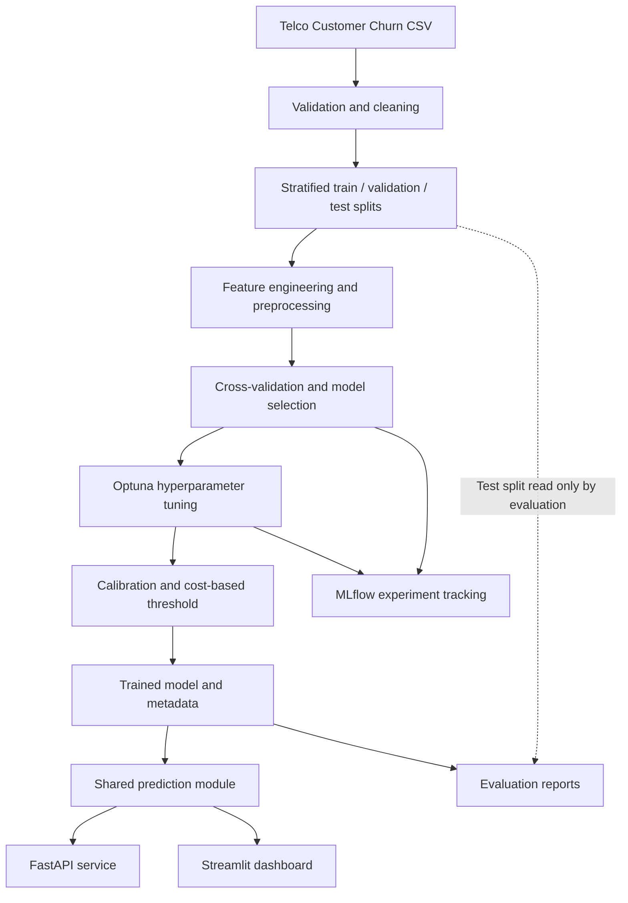
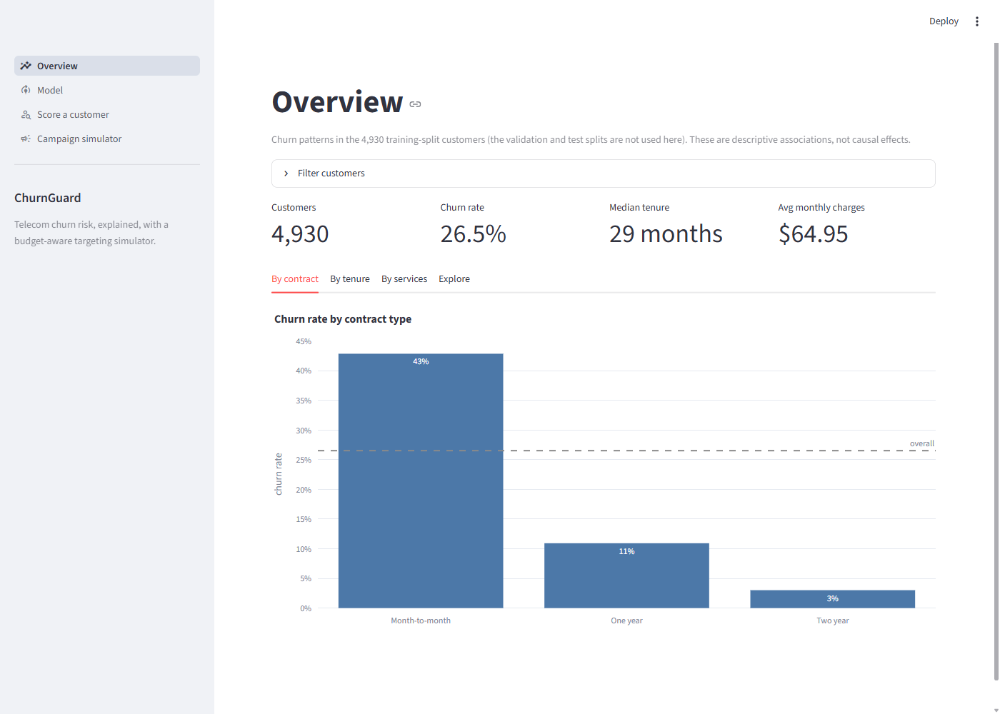
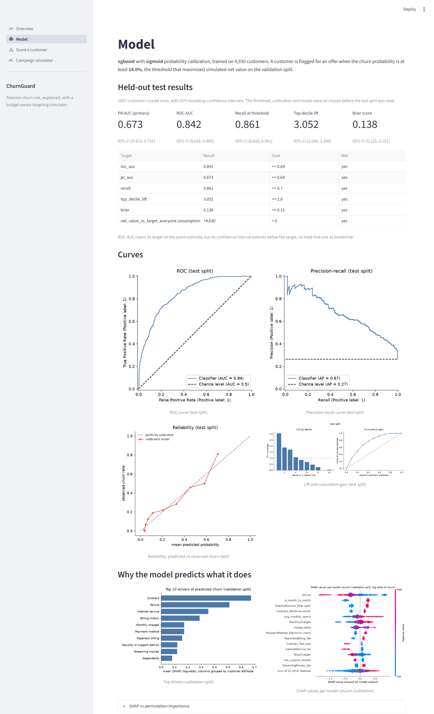
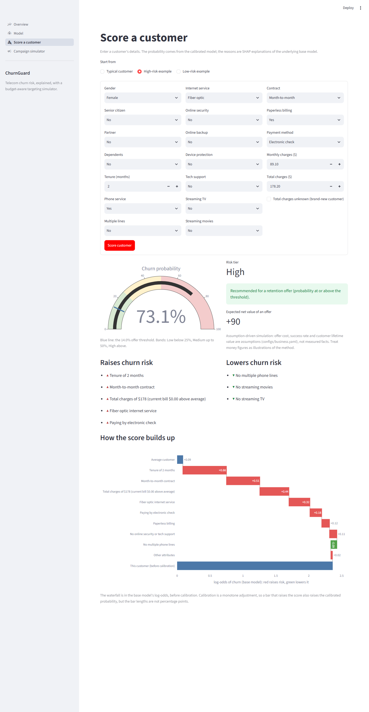
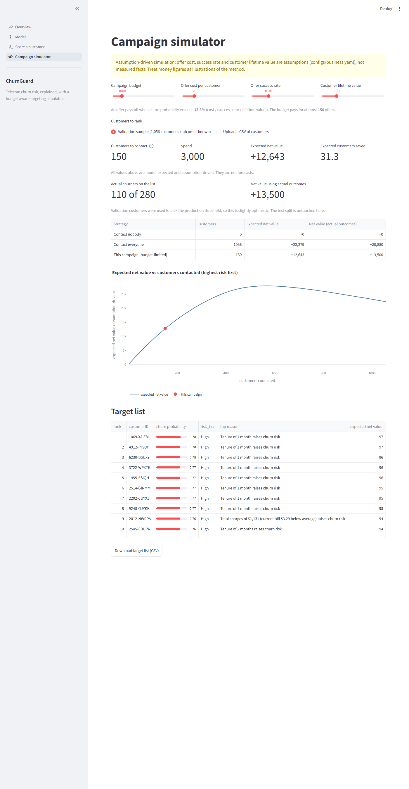

# ChurnGuard

**An end-to-end, explainable telecom customer churn prediction and retention decision-support system.**

ChurnGuard helps telecom teams identify customers at risk of leaving, understand the factors contributing to each prediction, and prioritize retention outreach under a configurable budget.

The project brings together a reproducible machine-learning workflow, model evaluation, explainability, a cost-sensitive campaign simulator, a FastAPI inference service, and a Streamlit dashboard. The API and dashboard share a single inference implementation, and the application can be run locally or with Docker Compose.

> **Important — assumption-driven simulated business economics:** Offer cost, retention success rate, and customer lifetime value are configurable assumptions in `configs/business.yaml`. They are not measured business outcomes. Model-quality metrics are computed on held-out data; financial results are illustrative simulations based on those assumptions.

## Table of contents

- [Highlights](#highlights)
- [Evaluation results](#evaluation-results)
- [How it works](#how-it-works)
- [Architecture](#architecture)
- [Screenshots](#screenshots)
- [Getting started](#getting-started)
- [Run with Docker](#run-with-docker)
- [API reference](#api-reference)
- [Dashboard](#dashboard)
- [Data drift check](#data-drift-check)
- [Project structure](#project-structure)
- [Engineering practices](#engineering-practices)
- [Documentation](#documentation)

## Highlights

- **End-to-end ML workflow:** data validation, cleaning, stratified splitting, feature engineering, model comparison, hyperparameter tuning, calibration, and evaluation.
- **Leakage-aware training:** preprocessing is encapsulated in scikit-learn pipelines and fitted within training folds.
- **Model comparison and experiment tracking:** evaluate baseline and candidate classifiers with cross-validation, tune with Optuna, and track experiments in MLflow.
- **Actionable churn scores:** return a churn probability, risk tier, targeting decision, and customer-level explanations.
- **Explainable predictions:** use SHAP to produce feature contributions and plain-English reasons.
- **Budget-aware retention planning:** compare targeting strategies and rank customers using configurable business assumptions.
- **Multiple inference interfaces:** FastAPI endpoints for application integration and a Streamlit dashboard for interactive analysis.
- **Operational packaging:** Docker Compose, pinned runtime dependencies, automated tests, linting, and CI.

## Evaluation results

The following results are from the **held-out test split of 1,057 customers**. The test set was scored once after model and threshold choices had been finalized. Confidence intervals are 95% bootstrap intervals.

| Metric | Test result | 95% confidence interval | Project target |
|---|---:|---:|---:|
| PR-AUC (primary metric) | **0.673** | [0.613, 0.731] | ≥ 0.64 |
| ROC-AUC | **0.842** | [0.816, 0.869] | ≥ 0.84 |
| Recall at selected threshold | **0.861** | 0.820–0.901 | ≥ 0.70 |
| Top-decile lift | **3.05** | 2.69–3.39 | ≥ 2.8 |
| Brier score | **0.138** | [0.125, 0.151] | ≤ 0.15 |

The point estimates meet the stated accuracy targets. The confidence interval for ROC-AUC extends below its target, so that result should be interpreted with appropriate caution. At the selected low threshold, precision is 0.45; the operating point prioritizes recall so that more potential churners are identified.

### Model selection

Five-fold cross-validation on the training split produced the following PR-AUC scores:

| Model | Cross-validation PR-AUC |
|---|---:|
| Dummy baseline | 0.265 |
| Logistic regression | 0.662 |
| Random forest | 0.657 |
| XGBoost | 0.657 |
| LightGBM | 0.651 |

The four non-baseline models performed similarly in cross-validation. XGBoost was selected after achieving the strongest validation result during tuning (0.656 versus 0.636 for the next candidate). SMOTE did not outperform class weighting.

See [model comparison](reports/model_comparison.md) for details.

### Retention strategy simulation

The selected cost-sensitive threshold is **0.140**. On the test split, under the configurable business assumptions, the strategies compare as follows:

| Strategy | Customers contacted | Simulated net value | Churners reached |
|---|---:|---:|---:|
| Contact nobody | 0 | 0 | 0% |
| Contact everyone | 1,057 | 21,010 | 100% |
| Default threshold (0.5) | 229 | 17,620 | 53% |
| **Cost-optimal threshold (0.140)** | **533** | **25,640** | **86%** |
| Best list within a 3,000 budget | 148 | 13,240 | 38% |

These assumption-driven values are simulated, not realized revenue or measured campaign results. Under the current assumptions, contacting everyone is already profitable; the model's value is in prioritizing customers and avoiding outreach to lower-risk customers when resources are constrained, improving simulated net value by **4,630** versus contacting everyone.

For methodology, assumptions, confidence intervals, and limitations, see the [model card](reports/MODEL_CARD.md).

## How it works

1. **Prepare the data.** Retrieve the Telco Customer Churn dataset, validate its schema, clean it, and create stratified train, validation, and test splits.
2. **Build and compare models.** Apply preprocessing and feature engineering through a scikit-learn pipeline, compare candidate classifiers with cross-validation, and tune the selected model.
3. **Calibrate and select a decision threshold.** Use validation data to calibrate probabilities and choose a threshold based on the configured retention economics.
4. **Explain predictions.** Generate SHAP explanations and translate important feature contributions into readable customer-level reasons.
5. **Serve predictions.** Load the versioned model through one inference entry point used by both FastAPI and Streamlit.
6. **Evaluate once.** Run the finalized model on the held-out test split and generate metrics and reports.

## Architecture



## Screenshots

| Overview | Model evaluation |
|---|---|
|  |  |

| Customer scoring | Campaign simulator |
|---|---|
|  |  |

## Getting started

### Prerequisites

- Python **3.11**
- GNU Make
  - On Windows, use `mingw32-make` or install Make with `choco install make`.
- Git

Alternatively, use [uv](https://docs.astral.sh/uv/) to manage Python and the project environment.

### 1. Clone the repository

```bash
git clone https://github.com/Git-Kapish/ChurnGuard.git
cd ChurnGuard
```

### 2. Install dependencies

```bash
make setup
```

### 3. Prepare the dataset

```bash
make data
```

This downloads the IBM Telco Customer Churn dataset, validates and processes it, and writes the train, validation, and test artifacts under `data/processed`.

If the automatic download is unavailable, place the Kaggle dataset file named `WA_Fn-UseC_-Telco-Customer-Churn.csv` at:

```text
data/raw/telco_churn.csv
```

Then run `make data` again.

### 4. Train and evaluate

```bash
make train
make evaluate
```

Training compares candidate models, performs hyperparameter tuning, calibrates probabilities, selects a cost-sensitive threshold, and generates explainability artifacts. Evaluation scores the held-out test split and writes reports and figures.

**The test split is intentionally read only by the evaluation step.** The evaluation command prevents accidental repeated scoring in the same checkout; use `--force` only when you explicitly intend to rerun it.

### 5. Run the tests and linters

```bash
make test
make lint
```

The test suite enforces a minimum coverage threshold of 80%.

### 6. Start the services

Run the API:

```bash
make api
```

Run the dashboard in a separate terminal:

```bash
make app
```

Open:

- **API:** http://localhost:8000
- **Interactive API documentation:** http://localhost:8000/docs
- **Streamlit dashboard:** http://localhost:8501

To inspect tracked experiments, run:

```bash
make mlflow
```

Then open the MLflow UI at the local address printed by the command.

### Existing trained model

The repository includes a trained model at `models/churn_model_v1.joblib` and committed evaluation reports. After installing dependencies and preparing the processed data, the API and dashboard can be started without retraining.

## Run with Docker

Prepare the processed dataset first, since the dashboard reads it from a mounted directory:

```bash
make data
docker compose up --build
```

Alternatively:

```bash
make docker-up
```

The services are available at:

| Service | URL |
|---|---|
| FastAPI | http://localhost:8000 |
| FastAPI documentation | http://localhost:8000/docs |
| Streamlit | http://localhost:8501 |

The application uses a multi-stage Docker build, runs as a non-root user, and installs pinned runtime dependencies from `requirements.lock`. Training-only dependencies such as MLflow and Optuna are not included in the runtime image.

## API reference

The FastAPI service exposes the following endpoints:

| Endpoint | Method | Description |
|---|---|---|
| `/health` | GET | Service health and loaded model version |
| `/model/info` | GET | Model metadata, evaluation metrics, threshold, and feature information |
| `/predict` | POST | Score one customer and return probability, risk tier, targeting decision, and reasons |
| `/predict/batch` | POST | Score up to 1,000 customers; use `?explain=false` to skip explanations |
| `/predict/csv` | POST | Score an uploaded CSV (up to 1,000 rows and 2 MB) and return the input data with score columns |

### Example: score one customer

```bash
curl -X POST "http://localhost:8000/predict" \
  -H "Content-Type: application/json" \
  -d '{
    "gender": "Female",
    "SeniorCitizen": 0,
    "Partner": "No",
    "Dependents": "No",
    "tenure": 2,
    "PhoneService": "Yes",
    "MultipleLines": "No",
    "InternetService": "Fiber optic",
    "OnlineSecurity": "No",
    "OnlineBackup": "No",
    "DeviceProtection": "No",
    "TechSupport": "No",
    "StreamingTV": "No",
    "StreamingMovies": "No",
    "Contract": "Month-to-month",
    "PaperlessBilling": "Yes",
    "PaymentMethod": "Electronic check",
    "MonthlyCharges": 89.1,
    "TotalCharges": 178.2
  }'
```

The response includes a churn probability, a risk tier, a `will_target` decision, and plain-English explanations. Invalid categories, missing fields, and out-of-range values are rejected with a descriptive HTTP 422 response.

## Dashboard

The Streamlit application provides four pages:

| Page | Capabilities |
|---|---|
| **Overview** | Overall churn rate and churn breakdowns by contract, tenure, and service, with filters |
| **Model** | Held-out metrics and confidence intervals, evaluation curves, SHAP analysis, data slices, and model comparison |
| **Score a customer** | Interactive customer form, churn-probability gauge, plain-English reasons, and SHAP waterfall |
| **Campaign simulator** | Budget and business-assumption controls, ranked target list, strategy comparison, and CSV export |

## Data drift check

The repository includes a Population Stability Index (PSI) utility to compare a new customer file with the training data distribution.

```bash
python scripts/drift_check.py new_customers.csv --out drift.csv
```

Features with PSI greater than **0.2** are flagged. The script exits with code 1 when a feature crosses this threshold.

This is an offline demonstration for a supplied file, not a continuously running production monitoring service.

## Project structure

```text
ChurnGuard/
├── configs/
│   ├── model.yaml              # Model and training configuration
│   └── business.yaml           # Retention economics assumptions
├── src/churnguard/
│   ├── data/                   # Loading, validation, cleaning, splitting, drift
│   ├── features/               # Feature engineering and preprocessing
│   ├── models/                 # Model factory, CV, tuning, calibration, MLflow
│   ├── evaluation/             # Metrics, threshold selection, plots, test evaluation
│   ├── explain/                 # SHAP explanations and plain-English reasons
│   ├── api/                    # FastAPI app, schemas, CSV validation
│   └── predict.py              # Shared inference entry point
├── app/                        # Streamlit dashboard
├── scripts/                    # Dataset download and drift-check utilities
├── tests/                      # Unit and integration tests
├── models/                     # Trained model artifacts
├── reports/                    # Model card, comparisons, evaluation outputs
├── docs/screenshots/            # Dashboard screenshots
├── notebooks/                  # Exploratory data analysis
├── Dockerfile
├── docker-compose.yml
├── Makefile
├── pyproject.toml
└── requirements.lock
```

## Engineering practices

ChurnGuard is designed to make the workflow reproducible and the evaluation credible:

- **Leakage prevention:** preprocessing and feature transformations are part of the scikit-learn pipeline and are fitted on training folds only.
- **Test-set isolation:** model selection, calibration, and threshold selection use training and validation data. The held-out test set is reserved for final evaluation.
- **Single inference path:** FastAPI and Streamlit both call `src/churnguard/predict.py`, avoiding divergent prediction logic.
- **Configuration-driven behavior:** model settings live in `configs/model.yaml`; business assumptions live in `configs/business.yaml`.
- **Reproducibility:** random seeds are fixed at 42 and dependencies are pinned for the runtime environment.
- **Automated quality checks:** GitHub Actions runs Ruff, Black, and pytest with an 80% coverage floor. Pre-commit hooks provide the same linting checks locally.

The clean-checkout validation recorded for this project completed `make setup data train evaluate test lint` successfully, with 179 tests passing at 92% coverage. The retrained model reproduced the committed test metrics and selected threshold.

## Documentation

- [Product requirements document](PRD.md)
- [Model card: methodology, results, and limitations](reports/MODEL_CARD.md)
- [Model comparison report](reports/model_comparison.md)
- [Development and build rules](CLAUDE.md)

---

**ChurnGuard** is an applied machine-learning project demonstrating how churn predictions can be developed, evaluated, explained, and exposed through usable decision-support interfaces. The evaluation and financial simulation should be interpreted within the dataset and assumptions documented above.
